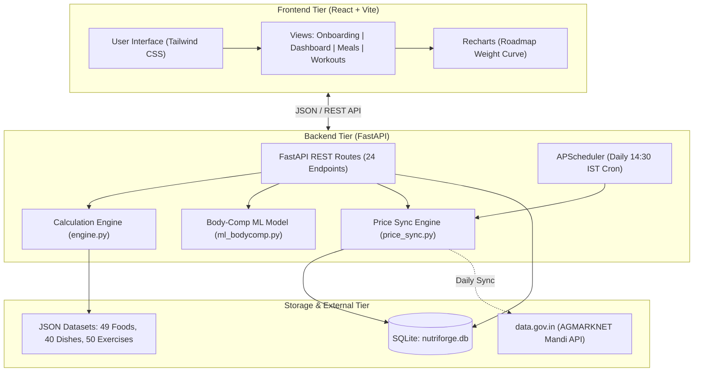
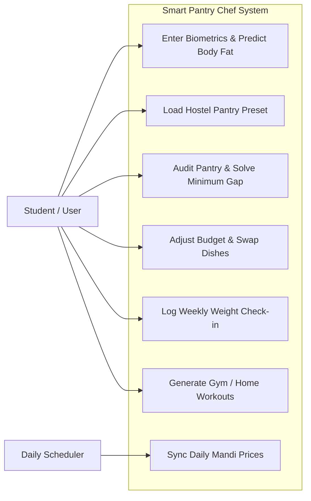
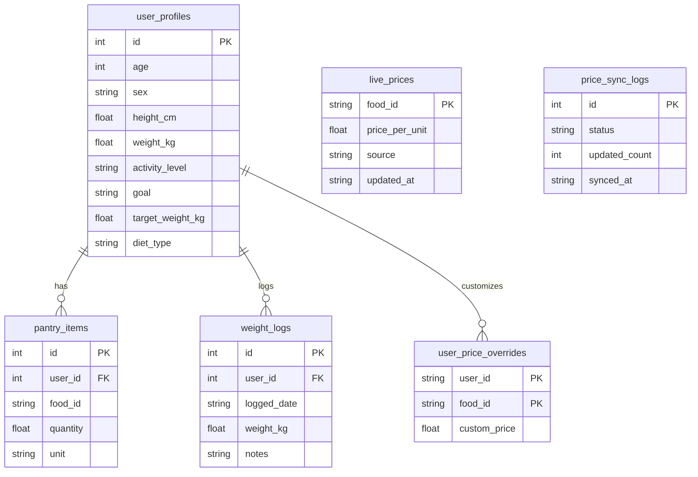

# SOFTWARE REQUIREMENTS SPECIFICATION (SRS)
## Project: Smart Pantry Chef (NutriForge)
**Document Standard:** IEEE Std 830-1998 Format  
**Academic Context:** B.Tech (2nd Year / Sem-3) — Software Engineering Course Project  
**Repository:** [https://github.com/Prabal2007/SmartPantry-Chef.git](https://github.com/Prabal2007/SmartPantry-Chef.git)  
**Live Application:** [https://smart-pantry-chef-tau.vercel.app/](https://smart-pantry-chef-tau.vercel.app/)  
**Version:** 1.1 (Final Submission)  
**Date:** 25th November 2026  

---

## TEAM CONTRIBUTION & ROLE DISTRIBUTION

| Team Member | Roll Number | Assigned Engineering Role | Core Module Ownership |
| :--- | :--- | :--- | :--- |
| **Member 1 (Lead)** | `[Roll No 1]` | **Project Lead & Biometrics Engineer** | Biometrics & Target Math (Mifflin/Katch-McArdle), Weight Projection Roadmap |
| **Member 2** | `[Roll No 2]` | **Algorithm & Optimization Lead** | 5-Gate Pantry Sufficiency Audit, Minimum-Cost Gap Solver, Budget Slider |
| **Member 3** | `[Roll No 3]` | **Backend & Database Architect** | FastAPI REST Endpoints, SQLite Schema, AGMARKNET Daily Price Sync |
| **Member 4** | `[Roll No 4]` | **Frontend UI & Quality Assurance Lead** | React/Vite Interface, Workout Generator, Automated `pytest` Test Suite |

---

## 1. INTRODUCTION

### 1.1 Purpose
The purpose of this document is to specify the software requirements for **Smart Pantry Chef (NutriForge)**. This web application helps users—particularly budget-conscious university students and home cooks—achieve their target physique without food waste. It audits current pantry ingredients, calculates nutritional gaps, finds the cheapest way to fill those gaps using live government market prices, and creates customized 7-day meal and workout plans.

### 1.2 Document Conventions
* **Requirement IDs:** `FR-x` for Functional Requirements, `NFR-x` for Non-Functional Requirements.
* **Priority Levels:**
  * **High (P0):** Core mathematical and plan generation features.
  * **Medium (P1):** Live price sync, database persistence, and weekly check-ins.
  * **Low (P2):** UI animations and custom dish swapping.
* The keyword **"shall"** indicates a mandatory requirement.

### 1.3 Project Scope

| In-Scope (Implemented Features) | Out-of-Scope (Deliberately Excluded) |
| :--- | :--- |
| • BMR, TDEE, and exact macro targets ($4\text{P} + 4\text{C} + 9\text{F} = \text{kcal}$) | • Medical prescription or disease treatment |
| • 5-Gate weekly pantry sufficiency audit | • Grocery delivery or online payment gateway integration |
| • Minimum-cost grocery gap solver (₹/g protein) | • Paid quick-commerce grocery scraping |
| • Daily AGMARKNET government mandi price sync | • Barcode scanning hardware integration |
| • 7-day meal plans with verified YouTube recipe links | • Live wearable sensor (smartwatch) telemetry |
| • 3–6 day Gym vs. Home resistance workout timetables | • Calorie counting from photos using computer vision |

### 1.4 References
1. IEEE Std 830-1998: *Recommended Practice for Software Requirements Specifications*.
2. Mifflin, M. D., et al. (1990): *Predictive equation for resting energy expenditure*.
3. AGMARKNET Mandi Price API Protocol (`data.gov.in`), Ministry of Agriculture, India.

---

## 2. OVERALL DESCRIPTION

### 2.1 Product Perspective
Smart Pantry Chef is a standalone client-server web application. The frontend is built in React 18 with Vite, and the backend is a lightweight FastAPI service backed by SQLite. It also connects via a background cron scheduler to India's open agricultural data portal (`data.gov.in`) for live vegetable and fruit prices.

### 2.2 User Classes
1. **Hostel / University Student:** Has limited budget, simple pantry items, and wants high-protein meals with minimum extra grocery spending.
2. **Home Fitness Beginner:** Exercises at home without equipment and needs bodyweight workout plans with video guides.
3. **Gym Lifter:** Has access to gym equipment and tracks exact macronutrient grams and weekly weight changes.

### 2.3 Operating Environment
* **Frontend:** React 18.3, Vite 5.3, Tailwind CSS 3.4, Recharts 3.11 (runs in Chrome, Firefox, Safari, Edge).
* **Backend:** Python 3.11, FastAPI 0.110, SQLAlchemy 2.0, APScheduler 3.10.
* **Database:** SQLite 3 (`nutriforge.db`).
* **Machine Learning:** Scikit-learn 1.4 (`GradientBoostingRegressor` for tape-measure body fat estimation).

### 2.4 Design & Implementation Constraints
1. **Zero Phantom Ingredients:** Recommended dishes must only use items currently in the user's pantry or in their gap shopping cart.
2. **Calorie-Macro Identity:** Across all dishes, daily totals must strictly satisfy:
   $$\text{Calories} = \text{round}((\text{Protein}_{\text{g}} \times 4) + (\text{Carbs}_{\text{g}} \times 4) + (\text{Fats}_{\text{g}} \times 9))$$
3. **Price Sanity Clamp:** Daily mandi prices that deviate more than $\pm 50\%$ from catalog baseline are rejected to avoid market data spikes.
4. **Offline Resilience:** If government API keys are missing, the system automatically falls back to curated baseline catalog prices without crashing.

---

## 3. SYSTEM ARCHITECTURE & MODELS

### 3.1 System Architecture Diagram

### 3.2 Use Case Diagram

### 3.3 Database Entity-Relationship Diagram (SQLite)

---

## 4. FUNCTIONAL REQUIREMENTS

### FR-1: Biometrics & Target Macronutrient Calculation (Priority: High)
* **FR-1.1:** The system shall calculate Basal Metabolic Rate (BMR) using the Mifflin-St Jeor equation:
  * For males: $10W + 6.25H - 5A + 5$
  * For females: $10W + 6.25H - 5A - 161$
  * If body fat % is known, the system shall use the Katch-McArdle formula: $370 + (21.6 \times \text{LBM})$.
* **FR-1.2:** The system shall compute TDEE using standard activity multipliers ($1.2$ for sedentary to $1.725$ for active).
* **FR-1.3:** The system shall set daily calories by goal: Cut ($-400\text{ kcal}$, min floor $1400$ male / $1200$ female), Lean Bulk ($+300\text{ kcal}$), or Recomp ($0\text{ deficit}$).
* **FR-1.4:** The system shall calculate protein ($1.6\text{–}2.2\text{ g/kg}$), fats ($25\%$ of calories), and carbohydrates (remaining calories), ensuring exact mathematical identity.
* **FR-1.5:** The system shall estimate body fat % from tape measurements (waist, hip, arm, neck) using a Scikit-learn regression model with U.S. Navy formula fallback.

### FR-2: Pantry Intake & 5-Gate Sufficiency Audit (Priority: High)
* **FR-2.1:** The system shall allow users to enter pantry items by quantity and unit (`g`, `ml`, `piece`).
* **FR-2.2:** The system shall provide a 1-click **"Hostel Student Preset"** loading common student staples (soya chunks, eggs, rice, oats, lentils, onions, tomatoes).
* **FR-2.3:** The system shall filter out foods that violate the user's diet (`veg`, `eggetarian`, `non_veg`).
* **FR-2.4:** The system shall check pantry sufficiency across **5 Gates**:
  1. *Protein Gate:* $\ge 90\%$ weekly protein requirement.
  2. *Calorie Gate:* $\ge 90\%$ weekly calorie requirement.
  3. *Vegetable Gate:* $\ge 1400\text{g}$ total vegetables ($14\text{ servings}$).
  4. *Fruit Gate:* $\ge 7\text{ servings}$ fruit.
  5. *Dish Gate:* At least one cookable dish for every meal slot (Breakfast, Lunch, Snack, Dinner).
* **FR-2.5:** If all gates pass, the system shall show **"100% Pantry Covered (₹0 extra)"**. If deficient, it shall report exact missing amounts.

### FR-3: Minimum-Cost Gap Solver & Budget Variety Slider (Priority: High)
* **FR-3.1:** The system shall solve missing nutritional gates with the absolute lowest cost:
  * Missing slots: Adds ingredients for the cheapest compliant dish.
  * Missing vegetables/fruits: Adds the cheapest vegetable (e.g. spinach/onion) and fruit (e.g. banana).
  * Missing protein: Ranks foods by cost per gram of protein ($\text{Price} / \text{Protein}$) and buys the most cost-effective source (e.g. soya chunks / eggs).
* **FR-3.2:** The system shall generate an itemized grocery cart showing item name, quantity, unit price, and line cost.
* **FR-3.3:** The system shall offer an interactive **Extra Budget Slider (`+₹0` to `+₹1500`)** that unlocks higher-tier ingredients (paneer, curd, peanut butter) and diverse dishes.
* **FR-3.4:** The system shall allow users to swap any dish in their 7-day schedule with an alternative cookable dish, recalculating daily macros live.

### FR-4: Daily Mandi Price Sync & Local Price Overrides (Priority: Medium)
* **FR-4.1:** The system shall fetch wholesale modal prices daily at 14:30 IST from AGMARKNET (`data.gov.in`).
* **FR-4.2:** The system shall convert wholesale ₹/quintal ($100\text{ kg}$) to retail metric prices with a default $30\%$ retail markup.
* **FR-4.3:** The system shall apply a 3-tier price hierarchy:
  $$\text{User Custom Override} \succ \text{Live Mandi Price} \succ \text{Baseline Catalog Price}$$
* **FR-4.4:** The system shall allow users to enter their local kirana/market price overrides in Settings.

### FR-5: 52-Week Weight Roadmap & Weekly Check-In (Priority: Medium)
* **FR-5.1:** The system shall project target weight over time using the thermodynamic standard: $7,700\text{ kcal} \approx 1\text{ kg body mass}$.
* **FR-5.2:** Weekly rate of change shall be bounded (Cut: $-0.25$ to $-0.75\text{ kg/week}$, Bulk: $+0.15$ to $+0.45\text{ kg/week}$, Recomp: flat), clamping cleanly at target weight without overshoot.
* **FR-5.3:** The system shall record weekly weigh-ins in `weight_logs`. If weight stalls for 2 consecutive weeks, it shall suggest an automated $\pm 150\text{ kcal}$ adjustment.

### FR-6: Bimodal Resistance Workout Generator (Priority: Medium)
* **FR-6.1:** The system shall generate 3, 4, 5, or 6-day split resistance workout schedules.
* **FR-6.2:** The system shall provide an instant toggle between **With Gym** (barbells/machines) and **Without Gym** (home calisthenics).
* **FR-6.3:** Every exercise card shall list muscle group, sets, rep ranges, rest intervals, progression tips, and a verified YouTube tutorial link.

---

## 5. NON-FUNCTIONAL REQUIREMENTS

* **NFR-1 (Performance):** Meal plan generation (`POST /api/plan/generate`) shall execute in under $50\text{ms}$ on standard hardware because it runs entirely locally without slow external LLM prompts.
* **NFR-2 (Reliability):** If the government Mandi API is unreachable or times out, the backend shall log the failure and seamlessly serve cached or baseline prices.
* **NFR-3 (Data Integrity):** Calories across all dishes and summaries must strictly match $\text{round}(4\text{P} + 4\text{C} + 9\text{F})$.
* **NFR-4 (Usability):** The interface must be fully responsive on mobile phones ($360\text{px}+$) and desktops, with honest progress bars that do not hide overshoots.
* **NFR-5 (Security):** API keys (`DATA_GOV_IN_KEY`) must be stored in `.env` files and never exposed to the frontend.

---

## 6. REQUIREMENTS TRACEABILITY MATRIX (RTM)

The following table confirms that every requirement has been implemented and verified via automated test cases:

| Req ID | Feature Description | Code Implementation | REST API Endpoint | Pytest Test Case | Verification |
| :--- | :--- | :--- | :--- | :--- | :--- |
| **FR-1** | Biometrics & Macro Math | `backend/engine.py` | `POST /api/plan/generate` | `test_biometrics_mifflin_and_katch_mcardle` | **PASSED** |
| **FR-1.4**| Calorie-Macro Identity | `backend/engine.py` | `POST /api/plan/generate` | `test_calorie_macro_identity_on_all_dishes` | **PASSED** |
| **FR-1.5**| Body-Comp ML Model | `backend/ml_bodycomp.py` | `POST /api/predict/body-comp` | `test_body_comp_ml_endpoint` | **PASSED** |
| **FR-2.2**| Hostel Pantry Preset | `backend/main.py` | `POST /api/pantry/preset-student` | `test_pantry_preset_and_persistence` | **PASSED** |
| **FR-2.4**| 5-Gate Pantry Audit | `backend/engine.py` | `POST /api/plan/generate` | `test_sufficient_pantry_branch` | **PASSED** |
| **FR-3.1**| Minimum Gap Solver | `backend/engine.py` | `POST /api/plan/generate` | `test_deficient_pantry_and_minimum_gap_solver`| **PASSED** |
| **FR-3.3**| Extra Budget Slider | `backend/engine.py` | `POST /api/plan/upgrade-budget`| `test_extra_budget_variety_upgrade` | **PASSED** |
| **FR-3.4**| Swap Meal Slot Dish | `backend/engine.py`, `main.py`| `POST /api/plan/swap-dish` | `test_plan_swap_api_passthrough_recipe_links` | **PASSED** |
| **FR-4.1**| AGMARKNET Mandi Sync | `backend/price_sync.py` | `POST /api/prices/sync` | `test_wholesale_to_retail_conversion_and_outlier_median` | **PASSED** |
| **FR-4.3**| 3-Tier Price Hierarchy | `backend/price_sync.py` | `GET /api/foods` | `test_strict_three_tier_price_precedence` | **PASSED** |
| **FR-5.1**| 52-Week Weight Roadmap | `backend/engine.py` | `POST /api/plan/generate` | `test_weight_projection_cut_monotonic_and_zero_overshoot`| **PASSED** |
| **FR-5.3**| Weekly Check-in & Stall | `backend/main.py`, `models.py`| `POST /api/weight-log` | `test_checkin_lifecycle_and_exact_fidelity` | **PASSED** |
| **FR-6.1**| Workout Generator | `backend/engine.py` | `POST /api/plan/generate` | `test_workout_splits_gym_and_home` | **PASSED** |
| **NFR-1** | Diet Type Isolation | `backend/engine.py` | `POST /api/plan/generate` | `test_pure_veg_dish_recommendation_invariants`| **PASSED** |

---

## 7. PROJECT SIGN-OFF

This Software Requirements Specification accurately reflects the software architecture, database design, algorithms, and automated test cases of Smart Pantry Chef.

| Role | Student Name | Signature / Status |
| :--- | :--- | :--- |
| **Member 1 (Biometrics & Lead)** | `[Member 1 Name]` | Approved |
| **Member 2 (Optimization & Pricing)**| `[Member 2 Name]` | Approved |
| **Member 3 (Backend & Database)** | `Prabal Verma` | Approved |
| **Member 4 (Frontend UI & Testing)** | `[Member 4 Name]` | Approved |
